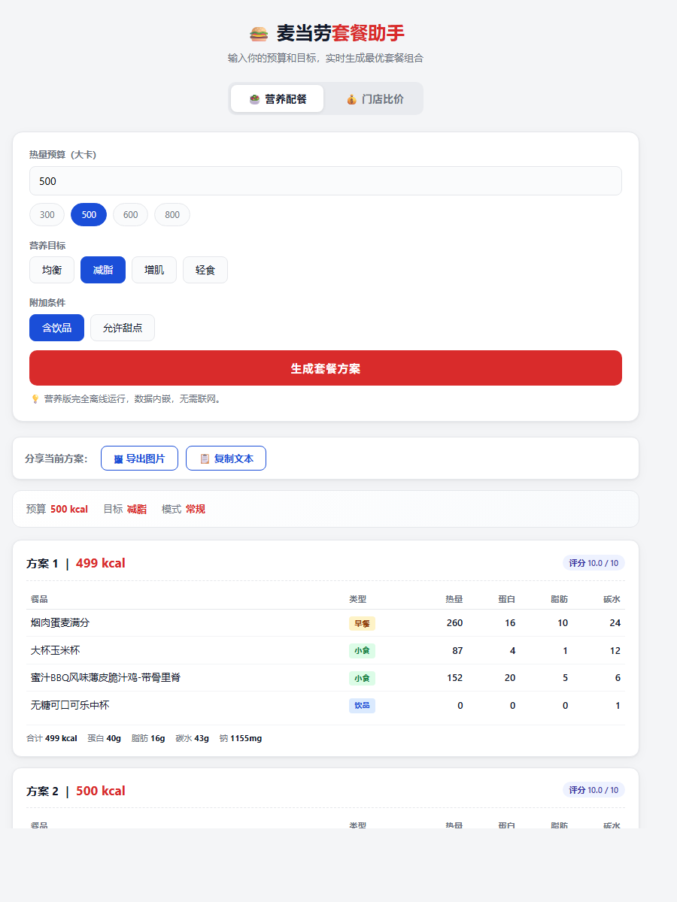
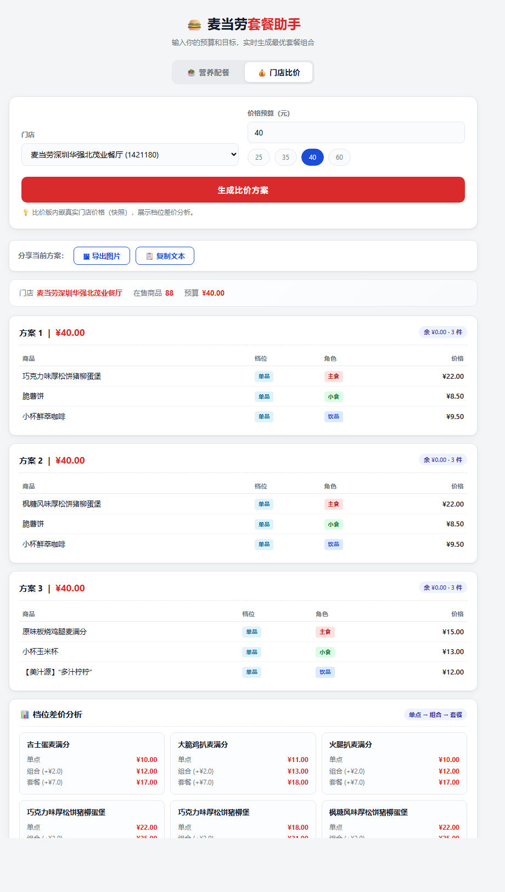

# 🍔 麦当劳套餐助手

> **"减脂，500 大卡能吃什么？"**
> **"预算 40 块，这家店怎么点最划算？"**
> —— 把你的条件输进去，直接给方案。

### 🎯 [**点此在线立即体验 →**](https://mcd-meal-planner.app.workbuddy.host/)

无需下载、无需注册、无需安装 —— 点开就能用。

**也可以在本地跑：** 一个 HTML 文件，双击即可（不装环境、不联网、不用填任何密钥）。

麦当劳程序员节创意开发大赛参赛作品 · 基于麦当劳中国官方 MCP 能力开发 · **非麦当劳官方产品**

⭐ **如果这个项目对你有用，点右上角 Star 支持一下** —— 比赛按 Star 数排名，你的每一个 ⭐ 都很重要 🙏



---

## 📖 项目介绍

在麦当劳点单时，消费者面对两个真实但**互相独立**的困惑：

| 困惑 | 典型问句 | 现有工具的缺口 |
|---|---|---|
| **营养困惑** | "我在减脂，500 大卡能吃什么？" | 官方只有一张静态营养表，不给组合方案 |
| **价格困惑** | "预算 40 块，这家店怎么点最划算？" | 门店菜单不标营养，档位差价看不明白 |

本项目不做"又一个菜单展示页"，而是把**约束条件**（热量预算 / 营养目标 / 价格预算）交给算法，
由程序**枚举 + 多目标评分**给出可执行的组合方案，并说清"为什么是这套"。

### 它和常见做法有什么不一样

| 常见做法 | 本项目 |
|---|---|
| 给一张营养表，看完还得自己算 | **直接给出组合方案**，并说明为什么选它 |
| 要下 App / 注册 / 登录 | **双击一个 HTML 文件**，零门槛 |
| 打开就要填 Token / 联网 | **完全离线**，无 Token 也能跑全部功能 |
| 只给菜单，不给建议 | **双引擎**：营养配餐 + 门店比价 |

---

## 🚀 安装方法（零安装）

### 方式一 · 在线体验（最快，推荐）

👉 **<https://mcd-meal-planner.app.workbuddy.host/>**

点开即用，无需下载、无需注册。

### 方式二 · 本地运行

| 步骤 | 操作 |
|---|---|
| **1** | 点本页右上角绿色 **`Code`** 按钮 → **`Download ZIP`** |
| **2** | 解压后，**双击 `app.html`**（Chrome / Edge 均可） |
| **3** | 设置参数 → 点「生成方案」→ 完成 ✅ |

> **不需要 Python、不需要联网、不需要 MCP Token。**
> 全部数据（160 项营养 + 88 项门店价）已内嵌在页面里，单文件 53 KB。

### 先看效果（不用下载）

**营养版** —— 输入「减脂 / 500 kcal」：

```
预算 500 kcal | 目标【减脂】
【方案】500 kcal · 蛋白 40g · 脂肪 15g · 碳水 46g · 钠 1250mg
    - 原味板烧鸡腿麦满分    246 kcal  [主食]
    - 大杯玉米杯            87 kcal  [小食]
    - 蜜汁BBQ脆汁鸡-里脊    152 kcal  [小食]
    - 小杯鲜萃咖啡           15 kcal  [饮品]
```

**比价版** —— 输入「深圳华强北 / 预算 ¥40」：

```
【方案1】合计 ¥40.00 ｜ 余 ¥0.00 ｜ 3 件
    - 巧克力味厚松饼猪柳蛋堡    ¥22.00  [单品/主食]
    - 脆薯饼                  ¥ 8.50  [单品/小食]
    - 小杯鲜萃咖啡             ¥ 9.50  [单品/饮品]
📊 档位差价：吉士蛋麦满分 组合 +¥2.0 / 套餐 +¥7.0
```



### 方式三 · 命令行版（可选）

```bash
git clone https://github.com/huohuo2026-stack/mcd-meal-planner.git
cd mcd-meal-planner

# 环境要求：Python 3.8+（仅标准库，无第三方依赖）
# 配置 MCP Token（在 https://open.mcd.cn 免费申请）
# Windows PowerShell：
[Environment]::SetEnvironmentVariable("MCD_TOKEN","YOUR_MCP_TOKEN","User")
```

---

## 👥 目标用户

| 人群 | 场景 | 用哪个模式 |
|---|---|---|
| **减脂 / 控糖人群** | 想在麦当劳吃得干净，但不知道哪些能组合、会不会超标 | 营养配餐 |
| **增肌人群** | 需要高蛋白低脂肪的一餐 | 营养配餐 |
| **价格敏感的学生 / 上班族** | 预算固定，想知道怎么点最划算、套餐和单点差多少 | 门店比价 |
| **选择困难症** | 就想快速得到一个"不用纠结"的答案 | 两个模式 |
| **开发者 / 参赛评委** | 想看 MCP 能力如何被编排成完整的用户闭环 | —— |

---

## ✨ 核心功能

### 模式一 · 营养配餐（离线可用）

- **输入**：热量预算 + 营养目标（均衡 / 减脂 / 增肌 / 轻食）
- **逻辑**：从 160 个标准餐品中枚举组合，按结构约束（必须含正餐主体）筛选，
  再按多目标评分排序（热量贴合度、蛋白质密度、脂肪控制、钠惩罚、结构完整度）
- **输出**：Top 3 方案，含逐项明细与营养合计
- **硬约束**：总热量**绝不超预算**（零容忍，实测 300～1000 kcal 七档全部满足）

### 模式二 · 门店比价（真实门店价）

- **输入**：门店 + 价格预算
- **逻辑**：读取该店实际在售商品（含单品 / 组合 / 套餐三档），按"花满预算优先、主餐不重复"组合，
  并做**档位差价分析**（同一主食的单点 → 组合 → 套餐差价）
- **输出**：Top 3 方案 + 档位差价表

### 方案可分享

生成方案后，页面出现两个按钮（**纯前端，离线可用**）：

| 按钮 | 行为 |
|---|---|
| 🖼 **导出图片** | Canvas 2x 高清绘制方案卡片 → 下载 PNG（1440×2102） |
| 📋 **复制文本** | 生成结构化文本写入剪贴板（`file://` 下自动降级 `execCommand`） |

---

## 💡 使用示例

### 网页版

| 想做什么 | 操作 |
|---|---|
| 减脂，500 大卡能吃什么 | 「营养配餐」→ 预算填 500 → 目标选「减脂」→ 生成方案 |
| 增肌，来 700 大卡 | 「营养配餐」→ 预算填 700 → 目标选「增肌」 |
| 40 块在这家店怎么点 | 「门店比价」→ 选门店 → 预算填 40 → 生成方案 |

### 命令行

```bash
# 营养版：500 大卡，减脂向
python cli.py 500 --profile 减脂

# 营养版：700 大卡，增肌向，出 5 个方案，不含饮品
python cli.py 700 --profile 增肌 --top 5 --no-drink

# 比价版：深圳华强北，预算 40 元，附档位差价分析
python cli.py --store 深圳市 华强北 --price-budget 40 --tier

# 数据集统计 / 联网刷新
python cli.py --stats
python cli.py --refresh
```

---

## 🔌 MCP 能力使用

本项目通过麦当劳官方 MCP Server（`https://mcp.mcd.cn`）获取数据，主要使用以下工具：

| 工具 | 用途 |
|---|---|
| `list-nutrition-foods` | 拉取全部餐品营养数据（160 项） |
| `query-nearby-stores` | 按城市 + 关键词检索门店 |
| `query-meals` | 查询门店在售餐品列表 |
| `query-meal-detail` | 查询餐品 / 套餐详情 |
| `calculate-price` | 批量计算价格（含档位差价） |

> 详细调用流程与业务价值见 **[MCP_INTEGRATION.md](MCP_INTEGRATION.md)**。

---

## 📊 数据来源与口径

| 数据 | 来源 | 规模 |
|---|---|---|
| 营养数据 | MCP `list-nutrition-foods` | **160 项**（早餐 15 / 主食 21 / 小食 26 / 甜点 11 / 饮品 87） |
| 门店价格 | MCP `query-meals` + `calculate-price` | **88 项**（麦当劳深圳华强北茂业餐厅 1421180） |

**两点诚实声明**：

1. **价格是快照，不是每次打开都联网拉取。** 这是刻意设计——为了让作品在**无 Token、无网络**环境下也能完整演示。
2. **营养库与门店菜单不重合。** 前者是全国统一标准品（有营养、无价格），后者是该店在售品（有价格、无营养），
   归一化后同名率约 **49%**，剩余差异是结构性的。因此**不强行融合两个模式**。

---

## 📂 项目结构

```
mcd-meal-planner/
├── README.md                本文件
├── CONTEST_DECLARATION.md   参赛声明（官方原文）
├── MCP_INTEGRATION.md       MCP 集成说明
├── workbuddy.md             WorkBuddy 开发上下文
├── mcp-config.example.json  MCP 配置示例（仅环境变量占位符）
├── SKILL.md                 Skill 定义（Agent 运行时加载）
├── app.html                 ★ 交互式应用（单文件，双击即用）
├── app_template.html        应用模板（数据占位）
├── build_app.py             构建 app.html（注入数据）
├── mcd_client.py            MCP 客户端（JSON-RPC + 工具封装）
├── build_dataset.py         营养数据集构建
├── planner.py               营养版推荐引擎
├── store_pricer.py          比价版引擎
├── pricing.py               价格表构建与匹配
├── cli.py                   命令行入口
├── verify_js.js             JS 算法验证（31 项）
├── check_structure.js       app.html 结构校验
├── test_e2e.py              端到端测试（Python 16 项）
├── images/                  演示截图
└── data/
    ├── nutrition.json       营养数据集（160 条）
    └── price_cache.json     门店价格缓存
```

---

## 🔧 技术要点

- **MCP 接入**：JSON-RPC 2.0 over Streamable HTTP，标准库 `urllib` 实现，无第三方依赖
- **算法**：枚举 + 多目标加权评分；候选池按角色分组，笛卡尔积组合
- **零依赖**：后端仅用 Python 标准库，前端仅用原生 JS，**无任何框架**
- **单文件交付**：`app.html` 内嵌全部数据，双击即用
- **可验证**：JS 算法验证（31 项）+ Python 端到端（16 项），双端一致性交叉验证

### 已实测的接口陷阱（工程记录）

| # | 陷阱 | 后果 | 防御方式 |
|---|---|---|---|
| 1 | `calculate-price` 的 items 键名必须是 `productCode` | 用 `code` 会返回 `success=true` 但价格全为 0（**静默错误**） | 自动纠正 + 0 元断言 |
| 2 | 价格单位是**分** | `2600` = ¥26.00 | 统一换算 |
| 3 | `beCode` 在到店自取场景不能传 | 传了报错 | 按 `beType` 条件传参 |
| 4 | `query-nearby-stores` 需 city + keyword 同时给 | 只给 city 报 600058 | 参数校验 |
| 5 | `query-meals` 不返回餐品名 | 无法直接建名称映射 | 用批量比价换名称 |
| 6 | 两套数据体系不重合 | 同名率仅约 49% | 两模式分开，不强行融合 |

---

## ⚠️ 局限

| 局限 | 说明 |
|---|---|
| 门店覆盖 | 当前仅缓存 1 家门店，换城市需重新抓取 |
| 价格时效 | 快照价，非实时 |
| 营养与价格割裂 | 两套数据不重合，暂无法"既看营养又看价" |

---

## ⭐ 支持这个项目

如果这个小工具帮你省下了一次纠结，欢迎：

- **点右上角 Star** ⭐ —— 我正在参加「麦当劳程序员节创意开发大赛」，**排名按 Star 数计算**
- 把它**分享**给可能需要的朋友
- 提 **Issue** 告诉我你想要什么功能

谢谢！🙏

---

## 📄 声明

参赛项目为麦当劳程序员节创意开发大赛参赛作品，由参赛者独立开发，**非麦当劳官方产品**。
项目输出仅供参考，不构成医疗、营养或其他专业建议；餐品信息、价格及供应状态以麦当劳官方渠道的实时结果为准。

详见 [CONTEST_DECLARATION.md](CONTEST_DECLARATION.md)。
